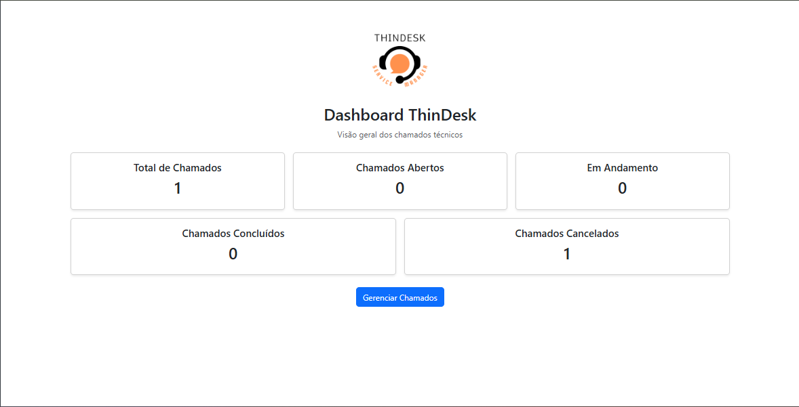

# ThinDesk — Sistema de Gerenciamento de Chamados Técnicos

Projeto acadêmico desenvolvido para a disciplina de **Desenvolvimento de Software Corporativo**, utilizando Java, Spring Boot, Spring Security, Thymeleaf e MongoDB Atlas.

O ThinDesk é uma aplicação web destinada ao gerenciamento de chamados de suporte técnico. O sistema integra autenticação de usuários, cadastro de clientes, gerenciamento de chamados e um dashboard com indicadores de atendimento.

## Aplicação publicada

O ThinDesk está disponível publicamente por meio da plataforma Render.

**Endereço da aplicação:** https://thindesk-app.onrender.com

A aplicação permite autenticação de usuários, gerenciamento de chamados técnicos e acompanhamento dos indicadores pelo dashboard.

**Observação:** por utilizar a modalidade gratuita do Render, o primeiro acesso após um período de inatividade pode demorar mais.

## Tecnologias utilizadas

- Java 23
- Spring Boot 3.4.0
- Spring Security
- Spring Data MongoDB
- MongoDB Atlas
- Spring Session MongoDB
- Thymeleaf
- Maven
- HTML, CSS e Bootstrap

## Funcionalidades

### Autenticação e segurança

- Cadastro de usuários com validações básicas.
- Armazenamento de senhas utilizando BCrypt.
- Autenticação por e-mail e senha.
- Login e logout com Spring Security.
- Proteção CSRF em formulários.
- Controle de acesso baseado em perfis.
- Persistência de usuários e sessões no MongoDB Atlas.

### Gerenciamento de chamados

- Cadastro de novos chamados técnicos.
- Listagem de chamados cadastrados.
- Edição das informações de chamados existentes.
- Atualização do status dos atendimentos.
- Cancelamento lógico de chamados, preservando os registros no banco de dados.
- Associação de informações de técnico e usuário aos chamados.

Os chamados utilizam os seguintes status:

| Status | Descrição |
|---|---|
| ABERTO | Chamado registrado e aguardando atendimento |
| EM_ANDAMENTO | Atendimento em andamento |
| CONCLUIDO | Atendimento finalizado |
| CANCELADO | Chamado cancelado, com registro preservado |

### Dashboard

A página inicial do ThinDesk apresenta um dashboard com indicadores calculados a partir dos chamados armazenados no MongoDB.

Os indicadores disponíveis são:

- Total de chamados.
- Chamados abertos.
- Chamados em andamento.
- Chamados concluídos.
- Chamados cancelados.

O dashboard também disponibiliza um botão de acesso ao gerenciamento de chamados.

## Captura de tela do Dashboard



*Dashboard da aplicação ThinDesk, apresentando os indicadores de gerenciamento de chamados.*

## Estrutura do projeto

O projeto utiliza uma organização em camadas:

- `controller`: recebe e processa requisições HTTP.
- `service`: concentra operações e regras de negócio.
- `repository`: realiza a persistência e consulta dos dados.
- `entity`: representa as entidades armazenadas no MongoDB.
- `templates`: contém as páginas HTML processadas pelo Thymeleaf.
- `templates/fragments`: contém componentes visuais reutilizáveis.
- `SecurityConfig.java`: configura autenticação e autorização.
- `UsuarioDetailsService.java`: integra os usuários do MongoDB ao Spring Security.

O gerenciamento de chamados utiliza principalmente `ChamadoController`, `ChamadoWebController`, `ChamadoService` e `ChamadoRepository`.

## Perfis de usuário

O projeto define os seguintes perfis:

- `ADMIN`: perfil administrativo.
- `SUPORTE`: perfil de suporte técnico.
- `CLIENTE`: perfil atribuído automaticamente ao cadastro público.

A configuração de segurança utiliza os perfis para controlar o acesso às funcionalidades protegidas. O README original documenta restrições específicas para `/clientes/**` e `/api/chamados/**`.

## Requisitos para execução

- JDK 23.
- Acesso a uma instância do MongoDB Atlas.
- Maven Wrapper, incluído no projeto.
- IntelliJ IDEA ou outra IDE Java compatível.

## Configuração do MongoDB Atlas

Para executar a aplicação:

1. Disponibilize um cluster no MongoDB Atlas.
2. Configure um usuário de banco de dados com as permissões necessárias.
3. Autorize o acesso de rede à instância.
4. Obtenha a URI de conexão.
5. Configure a variável de ambiente `MONGODB_URI`.

O arquivo `application.properties` utiliza:

```properties
spring.data.mongodb.uri=${MONGODB_URI}
spring.data.mongodb.auto-index-creation=true

spring.session.store-type=mongodb
spring.session.mongodb.collection-name=sessions
server.servlet.session.timeout=30m
```

A variável `MONGODB_URI` deve conter o endereço de conexão válido do banco de dados, incluindo as credenciais necessárias.

**Por segurança, senhas e strings de conexão completas não devem ser publicadas no GitHub.**

## Como executar localmente

### IntelliJ IDEA

1. Abra a pasta do projeto que contém `pom.xml`.
2. Aguarde a importação das dependências Maven.
3. Configure a variável `MONGODB_URI` em **Run → Edit Configurations**.
4. Execute a classe principal `com.pfc.ThindeskApplication`.
5. Acesse a aplicação pelo navegador.

### Terminal do Windows

Com a variável de ambiente configurada, execute na pasta do projeto:

```powershell
.\mvnw.cmd spring-boot:run
```

O servidor utiliza a porta 8080 por padrão.

### Endereços locais

| Página | Endereço |
|---|---|
| Login | `http://localhost:8080/login` |
| Cadastro | `http://localhost:8080/cadastro` |
| Dashboard | `http://localhost:8080/` |
| Chamados | `http://localhost:8080/chamados` |

## Acesso à aplicação publicada

**Endereço público:** inserir o link após concluir o deploy.

A aplicação disponibiliza uma página de cadastro de usuários em `/cadastro` e autenticação em `/login`.

Antes da entrega final, o acesso público deverá ser testado em um navegador sem sessão previamente autenticada.

## Versionamento semântico

O projeto adota como referência o padrão **Semantic Versioning (SemVer)**, representado por:

`MAJOR.MINOR.PATCH`

Cada componente possui um significado:

- **MAJOR:** alterações incompatíveis com versões anteriores.
- **MINOR:** inclusão de funcionalidades compatíveis com versões anteriores.
- **PATCH:** correções de defeitos compatíveis com versões anteriores.

Também podem ser utilizados identificadores de pré-lançamento, como `alpha` e `beta`.

### Exemplo: 1.0.2-beta

- `1`: versão principal (MAJOR).
- `0`: versão secundária (MINOR).
- `2`: versão de correção (PATCH).
- `beta`: identificador de pré-lançamento, indicando uma versão disponibilizada antes da versão estável correspondente.

O versionamento semântico contribui para organizar a evolução do software, comunicar alterações e identificar versões disponibilizadas no repositório.

## Testes manuais

### Gerenciamento de chamados

Durante o desenvolvimento da atividade, foram realizados os seguintes testes:

- Inicialização da aplicação Spring Boot.
- Conexão com o MongoDB Atlas.
- Acesso ao sistema utilizando cadastro e login.
- Cadastro de um novo chamado técnico.
- Listagem do chamado cadastrado.
- Edição da descrição de um chamado.
- Cancelamento lógico de um chamado.
- Verificação da atualização do status para `CANCELADO`.
- Exibição dos indicadores do dashboard.

### Autenticação e autorização

A documentação original registra verificações relacionadas a:

- Armazenamento de senhas com BCrypt.
- Atribuição do perfil CLIENTE no cadastro público.
- Bloqueio de acesso de CLIENTE a determinadas rotas protegidas.
- Logout e proteção de acesso após encerramento da sessão.
- Persistência das sessões na coleção `sessions` do MongoDB.

Essas verificações pertencem ao histórico documentado do projeto e devem ser distinguidas dos testes realizados especificamente para a atividade final.

## Segurança e limitações

O sistema utiliza Spring Security, BCrypt e MongoDB Atlas para implementar autenticação, autorização e persistência.

O cancelamento de chamados é lógico, realizado pela atualização do status para `CANCELADO`, sem excluir o documento do banco de dados.

Por se tratar de um projeto acadêmico, a aplicação ainda requer avaliações adicionais de segurança, validações e testes antes de uma utilização em ambiente de produção.

## Finalidade acadêmica

O ThinDesk foi desenvolvido para demonstrar conceitos de Desenvolvimento de Software Corporativo, incluindo arquitetura em camadas, persistência de dados, autenticação, autorização, operações de gerenciamento de chamados e visualização de indicadores.

A implementação reúne funcionalidades desenvolvidas ao longo da disciplina e aprimoramentos realizados para a atividade prática individual final.